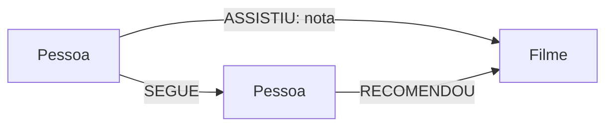

# Desafio DIO: Modelagem e consultas com Neo4j

Projeto prático de banco de dados em grafos com Neo4j e Cypher. O cenário usado é uma plataforma fictícia de streaming, em que pessoas assistem a filmes e podem recomendar títulos a outras pessoas.

## Objetivos
- Modelar nós, relacionamentos e propriedades.
- Carregar dados de arquivos CSV com Cypher.
- Consultar recomendações e padrões de visualização.
- Praticar atualização e remoção segura de dados.

## Modelo do grafo

- `(:Pessoa {id, nome, cidade})`
- `(:Filme {id, titulo, genero, ano})`
- `(:Pessoa)-[:ASSISTIU {nota}]->(:Filme)`
- `(:Pessoa)-[:SEGUE]->(:Pessoa)`
- `(:Pessoa)-[:RECOMENDOU]->(:Filme)`

## Estrutura

- `data/pessoas.csv`: amostra fictícia de pessoas.
- `data/filmes.csv`: amostra fictícia de filmes.
- `data/assistiu.csv`: relacionamentos de visualização.
- `cypher/01_constraints.cypher`: restrições de unicidade.
- `cypher/02_load_data.cypher`: carga dos dados.
- `cypher/03_business_queries.cypher`: consultas de negócio.
- `cypher/04_safe_updates_deletes.cypher`: exemplos de atualização e exclusão.
- `docs/modelo.md`: dicionário e modelo do grafo.

## Como executar

1. Inicie uma instância do Neo4j (Neo4j Desktop ou Aura).
2. Abra o Neo4j Browser e selecione o banco desejado.
3. Copie e execute `cypher/01_constraints.cypher`.
4. Coloque os CSVs em um local acessível pelo banco. Em instalações locais, use a pasta `import` da instância e ajuste os caminhos das consultas para `file:///pessoas.csv`, `file:///filmes.csv` e `file:///assistiu.csv`.
5. Execute `cypher/02_load_data.cypher` e depois as consultas em `cypher/03_business_queries.cypher`.

> Observação: no Neo4j Aura, o acesso a arquivos locais via `file:///` não funciona do mesmo modo que no Desktop. Use o mecanismo de importação disponível no ambiente ou adapte as consultas para os arquivos hospedados em um endereço acessível.

## Perguntas de negócio

1. Quais filmes cada pessoa assistiu?
2. Quais filmes receberam as melhores notas médias?
3. Quais filmes ainda não foram assistidos por uma pessoa?
4. Quais títulos foram recomendados por pessoas seguidas pelo usuário?
5. Como visualizar o esquema carregado? Execute `CALL db.schema.visualization()`.

## Cuidados com exclusões

- `DELETE r` remove apenas o relacionamento `r`.
- `DELETE n` falha se o nó ainda tiver relacionamentos.
- `DETACH DELETE n` remove o nó e os relacionamentos ligados a ele. Use com atenção.
- `REMOVE n:Label` remove apenas o label indicado.

Faça testes de exclusão em um banco de desenvolvimento e confirme o resultado com uma consulta `MATCH` antes de executar operações destrutivas.

## Troubleshooting

- **Nenhum CSV encontrado:** confira a pasta `import`, o nome do arquivo e as permissões de leitura.
- **Erro de unicidade:** verifique se os IDs dos CSVs não estão duplicados.
- **Relacionamentos duplicados após reexecutar a carga:** os scripts usam `MERGE` para evitar duplicação por chave.
- **Caminho de arquivo não aceito:** confirme o ambiente Neo4j e ajuste o método de importação conforme Desktop ou Aura.

## Evidências visuais

Depois de executar as consultas, salve capturas do Neo4j Browser mostrando o grafo e os resultados e adicione-as em `docs/screenshots/`. As capturas precisam ser geradas a partir de uma execução real; não há imagens de resultados simulados neste repositório.

## Tecnologias

- Neo4j
- Cypher
- CSV
- Mermaid para um diagrama inicial

## Dados

Todos os dados deste exemplo são fictícios e foram criados apenas para fins de estudo.

## Referências

- Documentação Cypher: https://neo4j.com/docs/cypher-manual/current/
- Importação de CSV: https://neo4j.com/docs/cypher-manual/current/clauses/load-csv/
- Exemplos oficiais: https://github.com/neo4j-graph-examples

---
Projeto de estudo para o desafio da DIO. Personalize as consultas, acrescente suas evidências e descreva aprendizados reais antes de entregar na plataforma.
