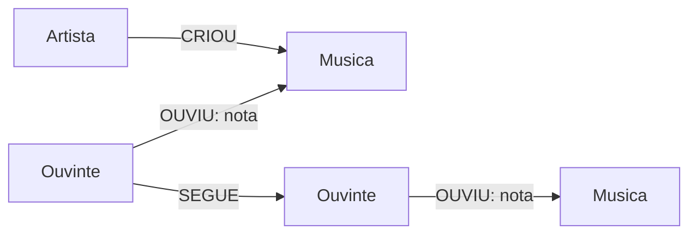

# Criando um Algoritmo de Recomendação de Músicas com Base em Grafos

Projeto do desafio da DIO que utiliza **Neo4j** e **Cypher** para modelar ouvintes, músicas e artistas e gerar recomendações com base nos hábitos de escuta e em pessoas com gostos semelhantes.

## Objetivo
Construir uma prova de conceito de recomendação: para um ouvinte, encontrar músicas que ele ainda não ouviu, mas que foram ouvidas e bem avaliadas por outros ouvintes com preferências parecidas.

## Modelo do grafo

- `(:Ouvinte {id, nome, cidade})`
- `(:Musica {id, titulo, genero, ano})`
- `(:Artista {id, nome})`
- `(:Ouvinte)-[:OUVIU {nota}]->(:Musica)`
- `(:Artista)-[:CRIOU]->(:Musica)`
- `(:Ouvinte)-[:SEGUE]->(:Ouvinte)`

## Estrutura do projeto

- `data/ouvintes.csv`: ouvintes fictícios.
- `data/artistas.csv`: artistas fictícios.
- `data/musicas.csv`: catálogo de músicas.
- `data/reproducoes.csv`: histórico de escuta e notas.
- `cypher/01_constraints.cypher`: restrições de unicidade.
- `cypher/02_load_data.cypher`: importação de dados.
- `cypher/03_business_queries.cypher`: exploração e recomendações.
- `cypher/04_safe_updates_deletes.cypher`: exemplos de atualização e exclusão.
- `docs/modelo.md`: dicionário e modelo do grafo.

## Como executar

1. Inicie um banco Neo4j local pelo Neo4j Desktop ou use uma instância Neo4j compatível.
2. Coloque os quatro CSVs na pasta `import` da instância local.
3. Abra o Neo4j Browser e execute `cypher/01_constraints.cypher`.
4. Execute `cypher/02_load_data.cypher` para importar os dados.
5. Execute as consultas em `cypher/03_business_queries.cypher`. Para testar recomendações por pessoas seguidas, a consulta inclui um exemplo de relacionamento `SEGUE`.
6. Para conferir o esquema, execute `CALL db.schema.visualization()`.

**Nota sobre importação:** os caminhos `file:///...` são apropriados para a pasta de importação em instalações locais, conforme a configuração do Neo4j. No Aura, use um método de importação compatível com o ambiente, como arquivos acessíveis por URL ou as ferramentas de importação disponíveis.

## Como funciona a recomendação

A consulta de recomendação identifica músicas ouvidas e bem avaliadas por outros ouvintes que o usuário segue, exclui músicas que o usuário já ouviu e ordena os resultados pela nota média. É uma regra explicável e simples, adequada a um projeto inicial. Em um sistema real, seria possível combinar gênero, artistas favoritos, popularidade, recência e métricas de avaliação.

## Perguntas que o grafo responde

1. Quais músicas um ouvinte já ouviu e que notas deu?
2. Quais músicas têm as melhores avaliações médias?
3. Quais músicas ainda não foram ouvidas por determinado usuário?
4. Quais músicas podem ser recomendadas a partir das preferências de pessoas seguidas?
5. Quais artistas criaram cada música?

## Cuidados com exclusões

- `DELETE r` remove apenas o relacionamento indicado.
- `DELETE n` não funciona se o nó ainda tiver relacionamentos.
- `DETACH DELETE n` remove o nó e todos os relacionamentos conectados. Use com cuidado.
- `REMOVE n:Label` retira apenas o label informado.

Faça testes em uma base de desenvolvimento antes de executar operações destrutivas.

## Troubleshooting

- **CSV não encontrado:** confirme a pasta `import`, o nome e as permissões do arquivo.
- **IDs duplicados:** confira os IDs dos CSVs e as restrições de unicidade.
- **Dados duplicados após reimportação:** os scripts usam `MERGE` para nós e relacionamentos identificados por chaves.
- **Nenhuma recomendação retornada:** confira se existem relacionamentos `SEGUE`, avaliações e músicas ainda não ouvidas pelo usuário de teste.

## Evidências visuais

Após executar as consultas no Neo4j Browser, salve capturas reais do grafo e dos resultados em `docs/screenshots/`. As imagens devem ser geradas após a execução, para comprovar que o modelo funciona.

## Tecnologias

- Neo4j
- Cypher
- CSV
- Mermaid para diagramas no README

Todos os dados incluídos são fictícios e servem apenas para fins educacionais.

## Referências

- Manual Cypher: https://neo4j.com/docs/cypher-manual/current/
- Importação CSV: https://neo4j.com/docs/cypher-manual/current/clauses/load-csv/
- Exemplos oficiais: https://github.com/neo4j-graph-examples

---
Projeto de estudo para o desafio DIO. Execute as consultas, adicione capturas reais e registre os aprendizados e ajustes que você fizer antes da entrega.