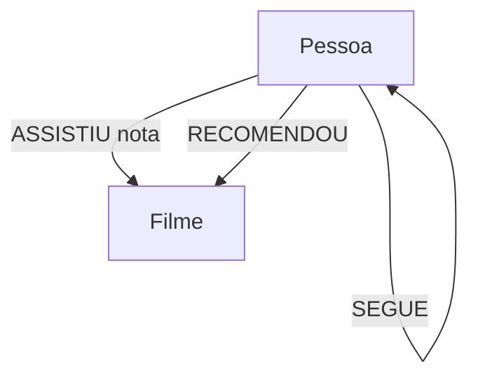

# Modelo do grafo

## Entidades

| Label | Propriedades | Descrição |
|---|---|---|
| `Pessoa` | `id`, `nome`, `cidade` | Pessoa usuária fictícia |
| `Filme` | `id`, `titulo`, `genero`, `ano` | Título do catálogo |

## Relacionamentos

| Tipo | Origem | Destino | Propriedades |
|---|---|---|---|
| `ASSISTIU` | `Pessoa` | `Filme` | `nota` (inteiro de 1 a 5) |
| `SEGUE` | `Pessoa` | `Pessoa` | Nenhuma neste exemplo |
| `RECOMENDOU` | `Pessoa` | `Filme` | Opcional para extensões futuras |

## Diagrama



Os CSVs fornecidos populam `Pessoa`, `Filme` e `ASSISTIU`. Para testar recomendações por pessoas seguidas, crie alguns relacionamentos `SEGUE`, por exemplo:

```cypher
MATCH (ana:Pessoa {id: 'P001'}), (bruno:Pessoa {id: 'P002'})
MERGE (ana)-[:SEGUE]->(bruno);
```

O relacionamento `RECOMENDOU` está reservado para uma extensão do exercício; a consulta inicial usa os filmes assistidos por pessoas seguidas como recomendações potenciais.
