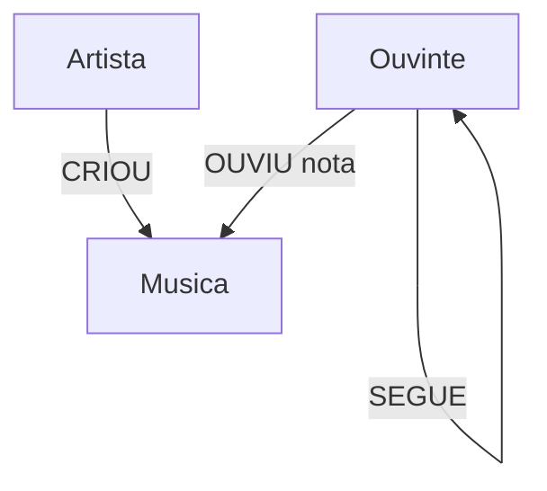

# Modelo do grafo: recomendação de músicas

## Nós

| Label | Propriedades | Finalidade |
|---|---|---|
| `Ouvinte` | `id`, `nome`, `cidade` | Pessoa que escuta músicas |
| `Musica` | `id`, `titulo`, `genero`, `ano` | Faixa musical do catálogo |
| `Artista` | `id`, `nome` | Artista associado a uma faixa |

## Relacionamentos

| Tipo | Origem | Destino | Propriedades |
|---|---|---|---|
| `OUVIU` | `Ouvinte` | `Musica` | `nota` de 1 a 5 |
| `CRIOU` | `Artista` | `Musica` | Nenhuma neste exemplo |
| `SEGUE` | `Ouvinte` | `Ouvinte` | Nenhuma neste exemplo |

## Diagrama



## Lógica de recomendação

Para um ouvinte-alvo, a consulta encontra músicas avaliadas com nota 4 ou 5 por pessoas que ele segue. Em seguida, exclui músicas que o alvo já ouviu e ordena as sugestões pela média das notas. É um modelo inicial, explicável e fácil de ampliar.

## Teste rápido

```cypher
MATCH (ana:Ouvinte {id: 'O001'}), (bruno:Ouvinte {id: 'O002'})
MERGE (ana)-[:SEGUE]->(bruno);
```

Os dados são fictícios e destinados apenas a estudo.
